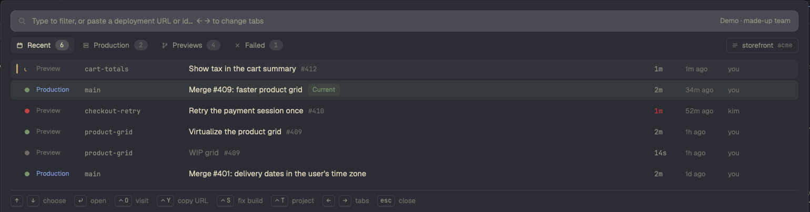

# Vercel for Herdr

A [Herdr](https://herdr.dev) mod: your Vercel deployments in a popup. The current production deployment is green. Open a deployment to see its URL, aliases, commit, pull request and the end of its build log. Redeploy, promote or cancel it. One key starts an agent on a failed build.

`RECIPE.md` tells how the mod looks and behaves, and how to build it from scratch.

## Install

1. Copy `mods/vercel/` into `~/.config/herdr-app/mods/`.
2. Merge `keys.json` into `~/.config/herdr-app/keys.json`. It binds ⌘E to open the popup.
3. Run `vercel login`, or set `VERCEL_TOKEN`.
4. Run `herdr-app check ~/.config/herdr-app/mods/vercel`.

To try it without a token, open the popup and run `herdr-app do vercel.demo`.

The mod runs `sh`, `curl`, `git` and `vercel whoami` to reach Vercel's API and to renew the CLI's token. It reads the Vercel CLI's `auth.json` and `config.json`, and `.vercel/project.json` in the shown repo.

## Credits

`mods/vercel/look.js` and the icons in `mods/vercel/icons/` come from the `linear` mod that ships with Herdr. They give this popup the same look as Herdr's Linear popup. They belong to Herdr's authors and are not covered by this repo's MIT license. The rest of the code is under the MIT license in `LICENSE`.
