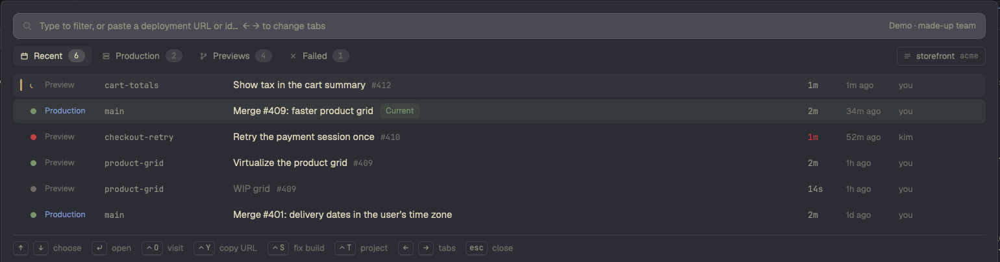

# Vercel

A popup with your Vercel deployments, in the same style as Herdr's Linear popup. ⌘E opens it. It shows the recent deployments, the production deployments, the previews and the failed deployments of one project or of all projects. The current production deployment has a green row and a "Current" label. Open a deployment to see its URL, aliases, commit, pull request and the last lines of its build log. From the popup you can open, redeploy, promote or cancel a deployment. One key starts a coding agent on a failed build, in a new tab of the space where the repo is.

## What you see

The popup is a Herdr overlay: `kind: "popup"`, at the top, 40px down, 80% of the window wide and high. The background is `theme().popover`, with 16px padding, a 10px gap between rows and 13px text. Colour shows state only. All surfaces use the theme's neutral colours. The state colours are: ready `ansi2`, building and starting `working` (else `ansi3`), failed `ansi1`, and queued, canceled and deleted `dim`.

**List screen**, top to bottom:

1. **Filter field.** 36px high, 9px radius, `input` (sunk) background, 1px `border` line, a 15px search icon on the left. The placeholder is "Type to filter, or paste a deployment URL or id…  ← → to change tabs". In demo mode, the right end shows "Demo · made-up team" in `muted`.
2. **Tab bar.** Four tabs, each 28px high with a 7px radius: **Recent** (calendar icon), **Production** (server icon), **Previews** (branch icon) and **Failed** (cross icon). Each tab has an 18px count pill that shows "–" until the count is known. The selected tab has a `raised` background, a small shadow and semibold text. While a tab loads for the first time, a spinning icon replaces its own icon. Below 700px width the labels become "All", "Prod", "Prev" and "Failed". At the right end is a 26px project chip with a 1px border: a project icon, the project name (or "All projects") and the team slug in mono. Click it to go to the next project.
3. **Deployment list.** Rows are 34px in 36px slots, in a virtual list up to 560px high, with a scrollbar. When all projects show, a 30px heading (the project name in upper case, the count, a 1px line) groups each project's deployments, newest first. A row shows, from left to right:
   - a 3px × 16px bar in the state colour, only on the selected row;
   - the state, in a 12px slot: an 8px dot in the state colour, or a 12px spinning work icon while the deployment builds or starts;
   - the target, 11.5px medium: "Production" in `accent` or "Preview" in `dim`, 74px wide ("Prod" and "Prev", 40px, below 760px);
   - the branch, 11.5px JetBrains Mono in `muted`, 170px wide (110px below 760px). Without a branch, the first part of the deployment URL;
   - the first line of the commit message, 13.5px in `foreground` (medium weight when selected, `dim` when canceled). Without a message, the URL. Then the PR number (`#412`, 11.5px mono, `dim`). Then, on the current production deployment, a "Current" chip in `ansi2`. The message truncates; the PR number and the chip do not.
   - "agent", if an agent works on the deployment (see How it behaves);
   - the build time (44px, 12px mono, `ansi1` for a failed build): `14s`, `2m`, `1h`. While it builds, the time so far;
   - how long ago it was made (64px);
   - the author (110px), at 760px and wider: the GitHub login, else the commit author's name, else the Vercel user.

   The selected row has a `raised` background and a small shadow. Other rows get the same background on hover. The current production row has a green background instead: `ansi2` at 12% alpha, 18% on hover, and 24% with a small shadow when selected.
4. **Note line** (when there is a note). A busy message in `accent` with a spinner, an error in `ansi1`, or a confirmation in `muted`.
5. **Footer.** A 1px top line, then keys as keycaps (20px, 5px radius, 2px bottom border, mono 11px) followed by what they do.

**Deployment screen**, top to bottom:

1. A back button with the tab name. Chips for the state (dot and word, in the state colour: Ready, Building, Starting, Queued, Failed, Canceled, Deleted), the target (Production in `accent`, or Preview), and "Current" in `ansi2` on the current production deployment. Then the short ID in mono (the ID without `dpl_`, first 9 characters) and the project name.
2. The commit message at 17px semibold, else the URL.
3. Fields, each a 72px label in `dim` and its value:
   - **URL**: the deployment URL as a mono chip. Click it to open the site.
   - **Aliases**: up to 4 aliases (not the URL itself), as mono chips that open.
   - **Source**: the branch (branch icon, mono), the commit SHA cut to 7 (a click opens the commit on GitHub) and the PR (PR icon, `#412`, in `accent`; a click opens the PR).
   - **Built**: the build time · "created 34m ago" · "by ⟨author⟩" · "via ⟨source⟩" (git, cli, redeploy…).
   - **Error**: Vercel's error message in `ansi1`, if there is one.
4. On a failed build without agents, a start banner with a 10% `accent` tint: "Start: an agent in a tab of ⟨space⟩, told to find why the build failed and fix it", with an accent **Start** button. If agents already work on it, an **AGENTS n** list shows them instead (up to 4 rows of 28px).
5. A 1px line, the heading "BUILD LOG · LIVE" (while it builds) or "BUILD LOG · LAST LINES" (10.5px semibold, `dim`), then a 320px scroll area with one code block: the last 80 lines of build output, ANSI codes removed. Without output: "*No build output.*".

**Action menu** (the **c** key). A card with a 10px radius, a `raised` background and a medium shadow, titled "⟨short ID⟩ · ⟨project⟩". Its items are 30px rows with a number from 1, only those that apply:
- **Cancel the build**, while it is queued, starting or building;
- **Promote it to production**, for a ready preview, or **Roll production back to it**, for a ready production deployment that is not the current one;
- **Redeploy (production)** or **Redeploy (preview)**, when it does not build.

**Sign-in screen.** Shown when Vercel rejects the token or there is no token. It has the title "Sign in to Vercel", a paragraph about `vercel login`, and an accent **Sign in** button.

## How it behaves

- **Agent status.** A deployment's agents are the agents whose tab name or terminal title contains its short ID. On a row: if one of them is `working`, a spinning work icon and "agent" in `working` colour. If none is working (`blocked`, `done` or `idle`), a person icon and "agent" in `dim`. On the deployment screen: a working agent has a spinning icon in `working` colour, a blocked agent has the need icon in `blocked` colour, and a done or idle agent has the idle icon in `dim`. The status word shows on the right. A click on an agent closes the popup and runs `agent.focus`.
- **List keys.** ↑ ↓ choose (page up/down move 12 rows). Enter opens the deployment; a click selects a row, and a second click opens it. ← → change tabs while the filter is empty. ⌃O opens the site, ⌃Y copies its URL, ⌃S starts an agent on a failed build, ⌃T goes to the next project. Esc closes the popup.
- **Filter.** Every word must match the URL, project, branch, commit message, author, short SHA, target, state word or `#PR`. If the text is a deployment ID (`dpl_…`) or a host name (`app-git-fix-team.vercel.app`, with or without `https://`), the mod looks it up in the whole team 300ms after you stop typing. Then the list shows only that deployment; if it is not in the tab, it shows under the heading "Not in this list".
- **Deployment keys.** **o** opens the site. **i** opens the deployment in the Vercel dashboard. **c** opens the action menu. **g** opens the PR. **s** starts an agent on a failed build, or goes to the agent if one is already on it. **y** copies the URL. **u** loads it again. ← or backspace goes back. In the menu: ↑ ↓, enter, or 1–9.
- **Actions.** Each action runs only from the menu, never from one key. The note line shows "Redeploying ⟨short ID⟩…", then "Redeploy started for ⟨short ID⟩.", "Promoted ⟨short ID⟩." or "Canceled ⟨short ID⟩.". After a redeploy from the deployment screen, the screen goes to the new deployment, so you see it build.
- **Start.** Only on a failed build. Opens a new tab named "⟨short ID⟩ build" in the space for the repo, with Claude Code (else the first installed agent). The agent's first message gives the URL, target, branch, commit and Vercel's error message, the dashboard link, and an instruction to read the build log with `vercel inspect --logs ⟨url⟩`, find the cause, fix it test-first, and say if our code did not cause it. The space for the repo is the shown space if a folder in its path has the name of the GitHub repo or the Vercel project, else another local space like that, else the shown space.
- **Pull request.** If Herdr's `github` mod is installed, **g** opens the PR there with `backTo`. Esc in the GitHub popup comes back to this deployment. Without the GitHub mod, **g** opens the PR in the browser.
- **Refresh.** All four tabs and the current production deployments load when the popup opens. A 10-second timer then loads them again if a listed deployment is queued, starting or building, else once a minute. On the deployment screen, the timer loads the deployment and its log again while it builds. Each action loads them again too. The lists are cached per project in `~/.config/herdr-app/vercel-cache.json`, so the popup shows the last lists at once.
- **Team.** The team is the `orgId` in `.vercel/project.json` of the shown space's repo (its Git top level), else `VERCEL_ORG_ID`, else the Vercel CLI's current team, else the first team the token sees.
- **Project.** The first project is the one you chose last, else the `projectId` in that `.vercel/project.json`, else the project with the name of the repo folder, else the only project, else all projects.
- **Demo.** `herdr-app do vercel.demo` switches demo mode on and off in a shown popup. The demo has a made-up team (`acme`, projects `storefront` and `docs`). Changes stay in memory, and "open" and "start" only say what they would do.

## Built from

- `mods/vercel/mod.json`: `{ "place": "none", "title": "Vercel", "overlay": { "kind": "popup", "at": "top", "offset": 40, "width": 0.8, "height": 0.8 } }`.
- `mods/vercel/main.js`: one `View`, with screens `list` and `deployment`, plus a menu and a sign-in state. The keyboard goes to the filter input on the list screen, and to a `focus_handle` on the deployment screen. `nextCommand()` takes `escape`, `next`, `prev`, `reload` and `demo`. Props: `deployment: { id }` (an ID or a host) opens that deployment directly; `backTo` is where the back button goes then.
- `mods/vercel/look.js`: `tones`, `tint`, `chip`, `key`/`cap` (keycaps), `countPill`, `ago`, `duration`, `icon`, `stateColor` and `STATE_WORDS`. A copy of the look of Herdr's shipped `linear` mod, so the popups match.
- `mods/vercel/demo.js`: `demoApi(method, path, body)` answers the same paths as the real API with made-up data.
- `mods/vercel/icons/`: back, branch, calendar, cross, idle, need, person, play, pr, project, search, server, work, and the key-* keycap glyphs. They are tinted with `svg()`. They come from Herdr's `linear` mod.
- `keys.json`: `"cmd-e": "mod.open:vercel"` in `global`, and `"mod:vercel": { "escape": "vercel.escape" }`.
- `herdr` functions: `exec`, `spaces`, `panes`, `agents`, `knownAgents`, `run`, `theme`, `props`, `appHome`, `openOverlay`, `closeOverlay`, `nextCommand`. Commands: `space.new` (sign-in), `space.select`, `tab.new {space, name, folder, argv, task}`, `agent.focus`.
- **Programs.** `sh` and `curl`, through `exec`, for every call. `git rev-parse --show-toplevel` finds the shown space's repo. One shell script does each call:
  - The token is `VERCEL_TOKEN`, else `token` in the Vercel CLI's `auth.json`. The script looks in `$XDG_DATA_HOME/com.vercel.cli`, `~/Library/Application Support/com.vercel.cli` and `~/.local/share/com.vercel.cli`, and takes the file with the latest `expiresAt` (seconds or milliseconds).
  - If that token expires within 60 seconds, the script runs `vercel whoami`, which makes the CLI renew it. If `vercel` is not on the PATH, it runs it in the login shell: `$SHELL -lic 'vercel whoami'`.
  - It sends the header to curl on stdin (`-H @-`), so the token is not in the script, in argv or in the mod's memory. curl prints the HTTP status on the last line.
  - Mode `conf` prints whether there is a token and the team (`VERCEL_ORG_ID`, else `currentTeam` in the CLI's `config.json`). Mode `refresh` renews the token. Any other mode is an HTTP method and a path.
  - The script exits with 64 when there is no token.
  - The sign-in button runs `vercel login` in a new space.
- **Vercel API** (`https://api.vercel.com`, with `teamId` on every call):
  - `GET /v9/projects?limit=100`: the projects, and `targets.production.id`, the current production deployment of each.
  - `GET /v2/teams/{id}`: the team slug. With no team known, `GET /v2/teams?limit=20` and the first one.
  - `GET /v6/deployments?limit=60&projectId=…` with `target=production`, `target=preview` or `state=ERROR` for the tabs.
  - `GET /v13/deployments/{id or host}`: one deployment, with `alias` and `errorMessage`.
  - `GET /v9/projects/{id}`: whether this deployment is the current one.
  - `GET /v3/deployments/{id}/events?builds=1&direction=backward&limit=240`: the build log, newest first.
  - `POST /v13/deployments?forceNew=1` with `{name, deploymentId, target?}`: redeploy (`target: "production"` only for a production deployment).
  - `POST /v10/projects/{projectId}/promote/{id}`: promote or roll back.
  - `PATCH /v12/deployments/{id}/cancel`: cancel a build.

## Watch out

- **Network, programs and files.** The mod reaches `api.vercel.com` with curl and runs `sh`, `git` and `vercel whoami`. It reads the Vercel CLI's `auth.json` and `config.json`, and `.vercel/project.json` in the shown repo. `vercel whoami` can rewrite the CLI's `auth.json` when it renews the token. The mod writes `vercel-cache.json` in the Herdr home folder.
- **The CLI's token expires after a few hours.** An expired token gets 403 with `error.invalidToken`, not 401. On 401, or on 403 with `invalidToken`, the mod renews the token and tries the call once more.
- **There can be two `auth.json` files.** The CLI writes to `$XDG_DATA_HOME/com.vercel.cli` when that variable is set, else to `~/Library/Application Support/com.vercel.cli` on macOS. Herdr's `exec` may not have `XDG_DATA_HOME`, and an old file can stay in the other folder. Pick the file by `expiresAt`, not by folder.
- **`vercel` may not be on Herdr's PATH** (for example when fnm or nvm installs Node from the shell profile). Hence the login-shell fallback.
- **`exec` has a 30-second limit.** curl gets `-m 25`. A token renewal adds a few seconds to the first call.
- **`${` in the shell script.** The script is a `String.raw` template, so every `${` in it must be written `${"${"}`.
- **Previews have `target: null`** in the API. The `target=preview` filter still works. Show a null target as Preview.
- **CLI deployments** (`vercel deploy --prebuilt`, common in CI) build somewhere else. Their log only shows the upload, and a build that fails in CI never reaches Vercel, so the Failed tab only shows builds that ran on Vercel.
- **Merge-ref messages.** CI often deploys a pull request's merge ref, whose message is "Merge ⟨sha⟩ into ⟨sha⟩". The mod shows "Pull request #n" instead, or the URL if no PR is known.
- **The PR number** comes from `meta.githubPrId`, else from `-pr-<n>-` in an alias or the URL. Aliases are only in the answer for one deployment, not in the list.
- **The list is one page of 60** per tab, newest first. There is no paging.
- **Nothing that changes Vercel runs on one key.** Redeploy, promote and cancel go through the menu, and promote is offered only for a ready deployment.
- **The real team can replace the demo.** If demo mode is switched on while the first real `start()` still waits on Vercel, the real team overwrites the demo's. `start()` checks `this.demo` after each await.
- **`fetch` is not used**, so the token stays out of JavaScript.
- **`URLSearchParams`** may not exist in the mod runtime. Build query strings with `encodeURIComponent`.
- **Agents are matched by name.** An agent counts for a deployment only if its tab or title contains the short ID. The start action names the tab that way, so its own agents match.
- **The space match is by folder name.** A folder in the space's path must have the name of the GitHub repo or the Vercel project. Only local spaces are matched. Remote spaces are not.

## Done when

- `herdr-app check ~/.config/herdr-app/mods/vercel` passes.
- With the Vercel CLI signed in, ⌘E opens the popup on the list. The four tabs get counts, and the project chip shows the project linked in the shown repo and the team slug.
- The current production deployment has a green row and a "Current" chip, and its deployment screen shows a "Current" chip too.
- Pasting a deployment URL from another project shows it under "Not in this list". Enter opens its screen with the URL, aliases, source, build time and the last lines of its build log.
- A deployment that builds has a spinner in its row and "BUILD LOG · LIVE" on its screen, and both update every 10 seconds until it is ready.
- **c** on a ready preview shows "Promote it to production" and "Redeploy (preview)". Redeploy goes to the new deployment, and the note says "Redeploy started for ⟨short ID⟩.".
- **s** on a failed build opens a tab named "⟨short ID⟩ build" in the repo's space, with Claude Code and the prompt. Opening the deployment again shows the agent in AGENTS, with a spinner while it works.
- With an expired CLI token, the popup still loads after the renewal. With no token, or after `vercel logout`, it shows the sign-in screen, and **Sign in** opens a space that runs `vercel login`.
- `herdr-app do vercel.demo` shows the `acme` team: 6 deployments in `storefront` (2 production, 4 previews, 1 failed), one of them building, and the current one green.
- Esc closes the menu, then the deployment screen, then the popup.
